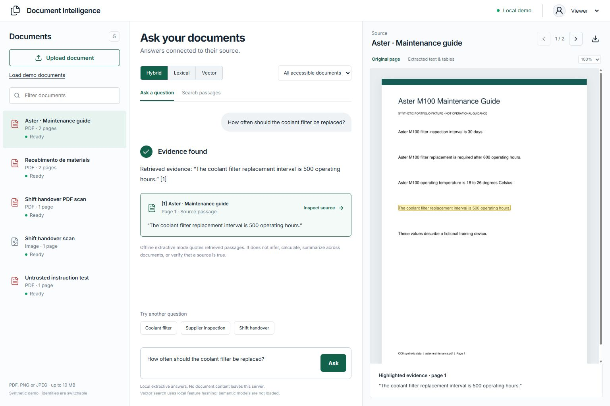
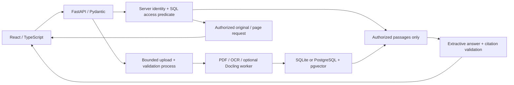
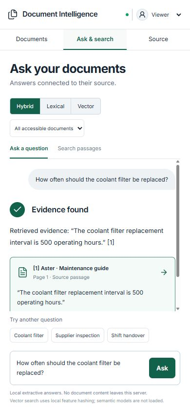
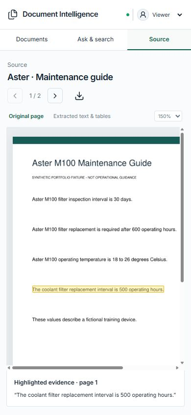

# Document Intelligence RAG

🇧🇷 [Leia este README em Português (Brasil)](README.pt-BR.md).

A working public portfolio application that takes a PDF or image through
extraction, retrieval, a cited answer and a highlighted original page. The demo
ships only fictional English and Portuguese documents.



## Implemented in v0.1

- Validated digital/scanned PDF, PNG and JPEG upload; asynchronous processing
  with queued, processing, ready and failed states.
- Page-aware PDF text, structured ruled tables and actual English/Portuguese
  Tesseract OCR. Passages retain identity, page, extraction engine and normalized
  top-left source rectangles.
- BM25 lexical retrieval, 384-dimensional local feature-hashing vectors and
  reciprocal-rank hybrid retrieval. PostgreSQL mode uses native pgvector cosine
  search; SQLite mode ranks locally with the same embedding function.
- Conservative extractive answers, verified retrieved citations and explicit
  insufficient-evidence responses. No paid API, remote model or provider key is
  required. No remote generation integration is implemented in this release.
- Document filtering, question/search modes, source pagination, zoom, original
  download, extracted tables and citation overlays. Mobile uses three panels.
- Server permissions on document queries, retrieval, previews and downloads.
  Demo identities are intentionally switchable and visibly identified.
- Optional verified Docling native parsing, Docker Compose, backend tests,
  frontend build, GitHub Actions and a versioned 18-question evaluation.

Vector hashing is a reproducible baseline, **not a pretrained semantic embedding
model**. Its reviewed bilingual vocabulary covers selected demo concepts, not
general translation. Answers quote one passage, without arithmetic, inference,
multi-document synthesis or verification of the source's truth.

## Try it locally

### Docker Compose

Requires Docker Compose and Python for the configuration initializer.

```powershell
python scripts/init_compose.py
docker compose up --build -d
```

Open **http://127.0.0.1:8100**. Compose runs the application and PostgreSQL 17
with pgvector; only the application is published to the host loopback interface.
The initializer creates an ignored `.env` with a random local database password
and preserves an existing `.env`.

Synthetic documents load on the first start. Wait a few seconds for processing.
`Load demo documents` is idempotent. Documents and database files persist in
named Docker volumes. `docker compose stop` stops this project's containers
while retaining data.

### Windows without Docker

Requires [uv](https://docs.astral.sh/uv/), Node.js 24 and Tesseract with `eng` and
`por` language data. The tested Windows installation was
`C:\Program Files\Tesseract-OCR\tesseract.exe`; elsewhere use PATH or set
`TESSERACT_CMD`. Use Python 3.11 for the tested environment.

Double-click **run-demo.bat**, or run:

```powershell
uv venv --python 3.11 .venv
uv pip install --python .venv/Scripts/python.exe -r backend/requirements.lock
cd frontend
npm ci
npm run build
cd ..
.venv/Scripts/python.exe -m uvicorn app.main:app --app-dir backend --host 127.0.0.1 --port 8100
```

The same URL serves React and the API. Local mode uses ignored `storage/`
and SQLite, with no network calls after dependencies are installed. Fonts are
bundled locally. The launcher saves its server PID and logs under `storage/`.
For frontend development, keep the API on port 8100 and run `npm run dev` in
`frontend/`; Vite on port 5173 proxies `/api` to the API.

### Demonstration workflow

1. Wait for the synthetic documents to show **Ready**.
2. Select **Coolant filter**, then **Ask**. Its answer cites the fictional
   500-hour coolant replacement interval on page 1 of the Aster guide.
3. Click the citation. Inspect the yellow source rectangle, zoom or navigate
   pages. **Extracted text & tables** shows retained structure.
4. Try **Supplier inspection** for Portuguese, or **Shift handover** for OCR.
   Upload a fixture from `fixtures/` to exercise ingestion.
5. Search **Papel A4** in **Search passages**, switching retrieval modes.
6. Ask **Who invented the Aster M100?** for a refusal without a citation.
7. Switch the explicit demo identity to **Reviewer** for the fictional restricted
   memo, then return to **Viewer**. Metadata, passages and files become
   inaccessible. This switch is not production authentication.

## Architecture and boundaries



Extraction, retrieval, generation, security and storage are separate modules
under `backend/app/`, with focused tests. Indexing retains page previews and
rectangles instead of reconstructing provenance afterward. The UI scales the
same normalized rectangle with the source image, including zoom.

SQL applies authorization before passages enter ranking or answering. pgvector
queries also include access predicates. Every original/preview request repeats
authorization and resolved-path containment checks. API responses use `no-store`.
Parser workers receive a restricted environment without server tokens or database
credentials; document text never drives tools, shell actions or model instructions.

Limits: 10 MiB per file, 20 pages, 20 million pixels per rendered/OCR image,
100 documents, two extraction and two validation workers, 12-second validation
and 65-second extraction process deadlines. OCR has a 20-second per-call limit.
Request bodies are bounded independently of `Content-Length`, with a 30-second
receive deadline and four concurrent body buffers. Encrypted, malformed, empty,
animated, unsupported and excessive-size documents are rejected. Native PDF/image
parsing is still a portfolio baseline, not a security sandbox.

The answerer treats source text as data, skips recognized instruction-injection
passages and requires meaningful query concepts to match one evidence passage.
Citation validation verifies ID, document, page, rectangle and an exact retrieved
quote. This validates provenance, not source truth or universal attack detection.

### Authentication scope

Default `DOC_INTEL_DEMO=true` enables random server-owned HttpOnly SameSite
sessions and the explicit Viewer/Reviewer switch. A role selector or role header
is not trusted production authentication.

`DOC_INTEL_DEMO=false` disables demo switching and seeding. API clients must then
send high-entropy bearer tokens configured through ignored
`DOC_INTEL_API_TOKENS`: a JSON object mapping tokens to server-owned identity
objects with `id`, `can_upload` and `can_restricted`. Never commit this variable.
This minimal API mechanism has tests; browser bearer sign-in is not implemented.
OIDC, per-user ownership, tenant isolation, audit logs, retention, token rotation
and production deployment remain future work. Keep the switchable demo local.

### Optional Docling

The default is PyMuPDF/Tesseract. `docling-native` was verified with Docling
2.135.0 on Python 3.11 through the actual worker, including rotated PDFs.
Install the CPU dependencies and `backend/requirements-docling.txt` in the
environment running the API, then:

```powershell
$env:DOC_INTEL_EXTRACTOR = 'docling-native'
.venv/Scripts/python.exe -m uvicorn app.main:app --app-dir backend --host 127.0.0.1 --port 8100
```

Restarting affects new processing, not already indexed documents. Docling's
model-free `NativePdfPipeline` supplies digital text/provenance; Tesseract OCR
and PyMuPDF tables remain in use. No model weights are downloaded. Full
model-based layout/table interpretation is not included or claimed. Scanned
tables remain OCR text with a visible manual-verification note. See the
[Docling document model](https://docling-project.github.io/docling/reference/docling_document/)
and [model setup FAQ](https://docling-project.github.io/docling/faq/).

## Verification and measured evaluation

```powershell
.venv/Scripts/python.exe -m pytest
.venv/Scripts/python.exe evals/run.py --check
cd frontend
npm ci
npm run build
```

Tests include real OCR, rotated PDF locations, tables, upload limits, failure
states, permissions, malicious text and citation forgery. Optional Docling tests
run when installed; PostgreSQL tests use `DOC_INTEL_TEST_DATABASE_URL` pointing
to an isolated pgvector database. CI supplies that database. Evaluation reads
only the versioned fixtures, not runtime uploads.

Measured on 18 authored cases (13 answerable, 5 unsupported), 56 extracted
passages and zero provider requests:

| Mode | Recall@3 | MRR@3 | Citation correctness | Unsupported refusal |
|---|---:|---:|---:|---:|
| Lexical | 1.0000 | 0.9103 | 1.0000 | 1.0000 |
| Vector baseline | 1.0000 | 1.0000 | 1.0000 | 1.0000 |
| Hybrid | 1.0000 | 0.9231 | 1.0000 | 1.0000 |

These are small synthetic regression results, not representative benchmark
claims. [Definitions](evals/README.md), [questions](evals/dataset.jsonl) and
[measured output with hashes/timings](evals/results.json) are inspectable.
Citation correctness checks expected quoted evidence and retained provenance;
it is not a human-annotated OCR localization benchmark. Evaluation ranks locally;
native PostgreSQL behavior has separate integration tests.

[Browser validation](docs/validation.md) records desktop/mobile workflows and
sanitized evidence. GitHub Actions checks backend, native pgvector integration,
synthetic regressions and the TypeScript/Vite build.

| Mobile answer | Mobile source |
|---|---|
|  |  |

## Public data, reuse and license

Six generator-authored fictional fixtures are dedicated to CC0 in
[fixtures/LICENSE.txt](fixtures/LICENSE.txt). `python fixtures/generate.py` regenerates
them; fonts can vary across platforms. Evaluation hashes identify exact binaries.
No real source documents were copied. Only synthetic screenshots are versioned.

Uploads, previews, extraction JSON, indexes, SQLite databases, secrets, optional
model caches and local settings are ignored. Docker build context also excludes
private/runtime locations. The three reference repositories were reviewed
read-only before implementation; [the audit](docs/reuse-audit.md) records license
and reuse decisions. Code and Git history are independent. PrintReady and other
live applications are outside this project.

Application code is **AGPL-3.0-or-later**, including its use of the AGPL-licensed
PyMuPDF dependency; see [LICENSE](LICENSE). Dependency/model licenses still apply.
[pgvector](https://github.com/pgvector/pgvector) documents the native PostgreSQL
cosine operations used by the adapter.
