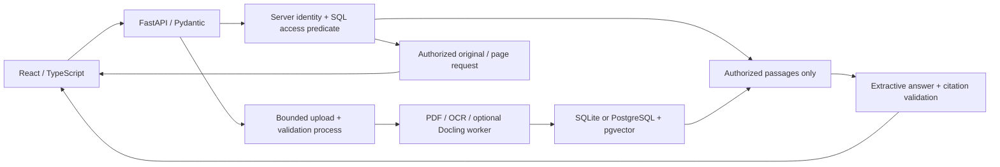

# Document Intelligence RAG

[English / README principal](README.md) · Português (Brasil)

Uma aplicação funcional de portfólio público que conduz um PDF ou uma imagem pelas
etapas de extração, recuperação, resposta com citações e destaque da página
original. A demonstração inclui apenas documentos fictícios em inglês e português.


## Implementado na v0.1

- Upload validado de PDFs digitais/digitalizados, PNG e JPEG; processamento
  assíncrono com estados de fila, processamento, pronto e falha.
- Texto de PDF com identificação de página, tabelas estruturadas com linhas
  delimitadoras e OCR real em inglês/português com Tesseract. Os trechos preservam
  identidade, página, mecanismo de extração e retângulos de origem normalizados
  com referência no canto superior esquerdo.
- Recuperação lexical BM25, vetores locais de 384 dimensões gerados por hashing
  de características e recuperação híbrida por fusão de posições recíprocas.
  O modo PostgreSQL usa busca nativa por cosseno com pgvector; o modo SQLite
  classifica localmente com a mesma função de embedding.
- Respostas extrativas conservadoras, citações recuperadas verificadas e respostas
  explícitas de evidência insuficiente. Não é necessária API paga, modelo remoto
  ou chave de provedor. Esta versão não implementa integração de geração remota.
- Filtro de documentos, modos de pergunta/busca, paginação da fonte, zoom, download
  do original, tabelas extraídas e sobreposições de citações. No celular, são usados
  três painéis.
- Permissões no servidor para consultas a documentos, recuperação, prévias e
  downloads. As identidades da demonstração podem ser alternadas intencionalmente
  e são identificadas de forma visível.
- Análise nativa opcional com Docling verificada, Docker Compose, testes de backend,
  build de frontend, GitHub Actions e avaliação versionada com 18 perguntas.

O hashing de vetores é uma linha de base reproduzível, **não um modelo de embedding
semântico pré-treinado**. Seu vocabulário bilíngue revisado abrange conceitos
selecionados da demonstração, não tradução geral. As respostas citam um único
trecho, sem aritmética, inferência, síntese de vários documentos ou verificação
da veracidade da fonte.

## Experimente localmente

### Docker Compose

Requer Docker Compose e Python para o inicializador de configuração.

```powershell
python scripts/init_compose.py
docker compose up --build -d
```

Abra **http://127.0.0.1:8100**. O Compose executa a aplicação e o PostgreSQL 17
com pgvector; apenas a aplicação é exposta na interface de loopback do host.
O inicializador cria um `.env` ignorado pelo Git com uma senha aleatória para o
banco local e preserva um `.env` existente.

Os documentos sintéticos são carregados na primeira inicialização. Aguarde alguns
segundos para o processamento. `Load demo documents` é idempotente. Documentos e
arquivos de banco persistem em volumes nomeados do Docker. `docker compose stop`
interrompe os contêineres deste projeto e preserva os dados.

### Windows sem Docker

Requer [uv](https://docs.astral.sh/uv/), Node.js 24 e Tesseract com os dados de
idioma `eng` e `por`. A instalação Windows testada foi
`C:\Program Files\Tesseract-OCR\tesseract.exe`; em outros locais, use o PATH ou
defina `TESSERACT_CMD`. Use Python 3.11 para reproduzir o ambiente testado.

Dê um clique duplo em **run-demo.bat** ou execute:

```powershell
uv venv --python 3.11 .venv
uv pip install --python .venv/Scripts/python.exe -r backend/requirements.lock
cd frontend
npm ci
npm run build
cd ..
.venv/Scripts/python.exe -m uvicorn app.main:app --app-dir backend --host 127.0.0.1 --port 8100
```

A mesma URL serve o React e a API. O modo local usa `storage/`, ignorado pelo Git,
e SQLite, sem chamadas de rede após a instalação das dependências. As fontes são
incluídas localmente. O inicializador salva o PID do servidor e os logs em `storage/`.
Para desenvolver o frontend, mantenha a API na porta 8100 e execute `npm run dev`
em `frontend/`; o Vite na porta 5173 encaminha `/api` para a API.

### Fluxo da demonstração

1. Aguarde até que os documentos sintéticos mostrem **Ready** (pronto).
2. Selecione **Coolant filter** (filtro de fluido de refrigeração) e depois **Ask**
   (perguntar). A resposta cita o intervalo fictício de 500 horas para troca do
   fluido na página 1 do guia Aster.
3. Clique na citação. Inspecione o retângulo amarelo da fonte, amplie ou navegue
   pelas páginas. **Extracted text & tables** (texto e tabelas extraídos) mostra a
   estrutura preservada.
4. Experimente **Supplier inspection** (inspeção de fornecedor) para português ou
   **Shift handover** (passagem de turno) para OCR. Faça upload de um arquivo de
   teste de `fixtures/` para exercitar a ingestão.
5. Busque **Papel A4** em **Search passages** (buscar trechos), alternando os modos
   de recuperação.
6. Pergunte **Who invented the Aster M100?** (quem inventou o Aster M100?) para
   obter uma recusa sem citação.
7. Alterne a identidade explícita da demonstração para **Reviewer** (revisor) para
   acessar o memorando fictício restrito e depois volte para **Viewer**
   (visualizador). Metadados, trechos e arquivos ficam inacessíveis. Essa troca
   não é autenticação de produção.

## Arquitetura e limites



Extração, recuperação, geração, segurança e armazenamento são módulos separados
em `backend/app/`, com testes específicos. A indexação preserva prévias das páginas
e retângulos, em vez de reconstruir a proveniência posteriormente. A interface
redimensiona o mesmo retângulo normalizado junto com a imagem da fonte, inclusive
ao aplicar zoom.

O SQL aplica a autorização antes de os trechos entrarem na classificação ou na
resposta. As consultas com pgvector também incluem condições de acesso. Cada
solicitação de original/prévia repete a autorização e as verificações de contenção
do caminho resolvido. As respostas da API usam `no-store`. Os processos de análise
recebem um ambiente restrito, sem tokens do servidor ou credenciais de banco;
o texto do documento nunca aciona ferramentas, ações de shell ou instruções para
modelos.

Limites: 10 MiB por arquivo, 20 páginas, 20 milhões de pixels por imagem renderizada
ou usada em OCR, 100 documentos, dois processos de extração e dois de validação,
com prazos de 12 segundos para validação e 65 segundos para extração. O OCR tem
limite de 20 segundos por chamada. Os corpos das requisições têm limites
independentes de `Content-Length`, com prazo de recebimento de 30 segundos e
quatro buffers de corpo simultâneos. Documentos criptografados, malformados,
vazios, animados, incompatíveis ou de tamanho excessivo são rejeitados. A análise
nativa de PDF/imagem ainda é uma linha de base de portfólio, não uma sandbox de
segurança.

O módulo de respostas trata o texto da fonte como dados, ignora trechos
reconhecidos como injeção de instruções e exige que conceitos relevantes da
consulta correspondam a um trecho de evidência. A validação de citações verifica
ID, documento, página, retângulo e uma citação exata recuperada. Isso valida a
proveniência, não a veracidade da fonte nem a detecção universal de ataques.

### Escopo da autenticação

O padrão `DOC_INTEL_DEMO=true` habilita sessões aleatórias HttpOnly SameSite
controladas pelo servidor e a troca explícita entre Viewer/Reviewer. Um seletor
de papel ou cabeçalho de papel não é autenticação confiável de produção.

`DOC_INTEL_DEMO=false` desabilita a troca e a carga inicial da demonstração.
Os clientes da API devem então enviar tokens bearer de alta entropia configurados
por meio de `DOC_INTEL_API_TOKENS`, ignorado pelo Git: um objeto JSON que associa
tokens a objetos de identidade controlados pelo servidor, com `id`, `can_upload`
e `can_restricted`. Nunca inclua essa variável em um commit. Esse mecanismo
mínimo de API tem testes; login no navegador com bearer não está implementado.
OIDC, propriedade por usuário, isolamento entre organizações, logs de auditoria,
retenção, rotação de tokens e implantação em produção continuam como trabalho
futuro. Mantenha a demonstração com troca de identidades em ambiente local.

### Docling opcional

O padrão é PyMuPDF/Tesseract. `docling-native` foi verificado com Docling 2.135.0
no Python 3.11 por meio do processo real de extração, incluindo PDFs rotacionados.
Instale as dependências de CPU e `backend/requirements-docling.txt` no ambiente
que executa a API e depois:

```powershell
$env:DOC_INTEL_EXTRACTOR = 'docling-native'
.venv/Scripts/python.exe -m uvicorn app.main:app --app-dir backend --host 127.0.0.1 --port 8100
```

Reiniciar afeta novos processamentos, não os documentos já indexados. O
`NativePdfPipeline` do Docling, sem modelo, fornece texto digital e proveniência;
o OCR do Tesseract e as tabelas do PyMuPDF continuam em uso. Nenhum peso de modelo
é baixado. A interpretação completa de layout/tabelas baseada em modelo não está
incluída nem é apresentada como implementada. Tabelas digitalizadas permanecem
como texto de OCR, com uma nota visível de verificação manual. Consulte o
[modelo de documentos do Docling](https://docling-project.github.io/docling/reference/docling_document/)
e as [perguntas frequentes sobre configuração de modelos](https://docling-project.github.io/docling/faq/).

## Verificação e avaliação medida

```powershell
.venv/Scripts/python.exe -m pytest
.venv/Scripts/python.exe evals/run.py --check
cd frontend
npm ci
npm run build
```

Os testes incluem OCR real, localização em PDFs rotacionados, tabelas, limites de
upload, estados de falha, permissões, texto malicioso e falsificação de citações.
Os testes opcionais do Docling são executados quando ele está instalado; os
testes de PostgreSQL usam `DOC_INTEL_TEST_DATABASE_URL` apontando para um banco
pgvector isolado. A CI fornece esse banco. A avaliação lê apenas os arquivos de
teste versionados, não os uploads de execução.

Medição em 18 casos elaborados (13 com resposta, 5 sem suporte), 56 trechos
extraídos e nenhuma solicitação a provedores:

| Modo | Recall@3 | MRR@3 | Correção das citações | Recusa de perguntas sem suporte |
|---|---:|---:|---:|---:|
| Lexical | 1.0000 | 0.9103 | 1.0000 | 1.0000 |
| Linha de base vetorial | 1.0000 | 1.0000 | 1.0000 | 1.0000 |
| Híbrido | 1.0000 | 0.9231 | 1.0000 | 1.0000 |

Esses são resultados pequenos de regressão sintética, não alegações de benchmark
representativo. É possível inspecionar as [definições](evals/README.md), as
[perguntas](evals/dataset.jsonl) e a
[saída medida com hashes/tempos](evals/results.json). A correção das citações
verifica a evidência citada esperada e a proveniência preservada; não é um
benchmark de localização por OCR anotado por humanos. A avaliação classifica
localmente; o comportamento nativo do PostgreSQL tem testes de integração
separados.

A [validação no navegador](docs/validation.md) registra fluxos de desktop/celular
e evidências sanitizadas. O GitHub Actions verifica backend, integração nativa
com pgvector, regressões sintéticas e o build TypeScript/Vite.

| Resposta no celular | Fonte no celular |
|---|---|
|  |  |

## Dados públicos, reutilização e licença

Seis arquivos fictícios criados pelo gerador são disponibilizados sob CC0 em
[fixtures/LICENSE.txt](fixtures/LICENSE.txt). `python fixtures/generate.py` os
regenera; as fontes podem variar entre plataformas. Os hashes de avaliação
identificam os binários exatos. Nenhum documento de fonte real foi copiado.
Apenas capturas sintéticas são versionadas.

Uploads, prévias, JSON de extração, índices, bancos SQLite, segredos, caches
opcionais de modelos e configurações locais são ignorados pelo Git. O contexto
de build do Docker também exclui locais privados/de execução. Os três
repositórios de referência foram revisados em modo de leitura antes da
implementação; a [auditoria](docs/reuse-audit.md) registra as decisões de licença
e reutilização. O código e o histórico Git são independentes. PrintReady e outras
aplicações em operação estão fora deste projeto.

O código da aplicação é **AGPL-3.0-or-later**, incluindo o uso da dependência
PyMuPDF licenciada sob AGPL; consulte [LICENSE](LICENSE). As licenças de
dependências/modelos continuam aplicáveis. O
[pgvector](https://github.com/pgvector/pgvector) documenta as operações nativas
de cosseno do PostgreSQL usadas pelo adaptador.
